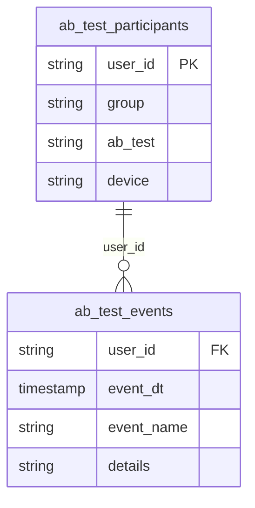

# Статистическая проверка продуктовых гипотез и оценка A/B-теста

Проект объединяет два прикладных статистических исследования: проверку гипотезы о региональных различиях активности пользователей книжного сервиса и аудит результатов A/B-теста нового интерфейса интернет-магазина BitMotion Kit (`interface_eu_test`).

**Автор:** Затула Денис Викторович  
**Стек:** Python (pandas, NumPy, Matplotlib, Seaborn, SciPy, statsmodels)  

---

## Бизнес-задачи

1. **Региональный анализ вовлеченности (книжный сервис):** проверить гипотезу о том, что пользователи из Санкт-Петербурга проводят в приложении за чтением и прослушиванием книг статистически значимо больше времени, чем пользователи из Москвы.
2. **Оценка A/B-теста нового интерфейса (`interface_eu_test`):**
   - проверить корректность проведения эксперимента (отсутствие пересечения групп, пересечение с параллельным тестом, сбалансированность по устройствам, достаточность размера выборки);
   - оценить влияние нового интерфейса на 7-дневную конверсию в покупку после регистрации при целевом пороге роста `+3 п.п.`;
   - подготовить рекомендацию по внедрению изменений.

---

## Структура проекта

```text
BooksCitiesABTest/
├── .gitignore                             # Исключения Git для Python, Jupyter, IDE и ОС
├── README.md                              # Описание проекта, структура данных и выводы
├── notebooks/
│   └── ab_test_analysis.ipynb             # Исследование, расчеты и статистические тесты
└── datasets/
    ├── yandex_knigi_data.csv              # Активность пользователей в Москве и СПб (8 784 строки)
    ├── ab_test_participants.csv           # Реестр участников A/B-тестов (14 525 строк)
    └── ab_test_events.zip                 # Лог пользовательских событий (787 286 строк)
```

---

## Данные и модель данных

### Схема связей таблиц A/B-теста (Часть 2)



### Описание полей

#### `yandex_knigi_data.csv` — Активность пользователей книжного сервиса (Часть 1)

| Поле | Тип данных | Бизнес-название | Описание |
| :--- | :--- | :--- | :--- |
| `city` | `string` | Город | Город пользователя (`Москва`, `Санкт-Петербург`) |
| `puid` | `int64` | Идентификатор пользователя | Уникальный идентификатор пользователя сервиса |
| `hours` | `float64` | Длительность активности | Суммарное время чтения и прослушивания книг в часах |

#### `ab_test_participants.csv` — Участники A/B-экспериментов (Часть 2)

| Поле | Тип данных | Бизнес-название | Описание |
| :--- | :--- | :--- | :--- |
| `user_id` | `string` | Идентификатор пользователя | Уникальный идентификатор участника эксперимента |
| `group` | `string` | Группа теста | Экспериментальная группа (`A` — контроль, `B` — тест) |
| `ab_test` | `string` | Название эксперимента | Идентификатор теста (`interface_eu_test`, `recommender_system_test`) |
| `device` | `string` | Тип устройства | Платформа пользователя (`Android`, `iPhone`, `PC`, `Mac`) |

#### `ab_test_events.zip` — События пользователей (Часть 2)

| Поле | Тип данных | Бизнес-название | Описание |
| :--- | :--- | :--- | :--- |
| `user_id` | `string` | Идентификатор пользователя | Ссылка на участника эксперимента |
| `event_dt` | `timestamp` | Время события | Дата и время совершения действия |
| `event_name` | `string` | Тип события | Этап воронки (`registration`, `login`, `product_page`, `product_cart`, `purchase`) |
| `details` | `string` | Детали события | Дополнительные параметры (например, стоимость покупки для `purchase`) |

---

## Ключевые результаты

### Часть 1. Активность пользователей книжного сервиса (СПб vs Москва)

- **Очистка данных:** из 8 784 строк исключены 488 дублирующих записей по пользователям, зафиксированным в обоих городах (5,56%). Итоговая выборка — 8 296 уникальных пользователей.
- **Сравнение средних:** средняя длительность активности в Санкт-Петербурге составила 11,26 ч, в Москве — 10,85 ч (разница +0,42 ч, или +3,8%). Распределения сильно смещены вправо (доля выбросов по IQR — около 14,5–15,0%).
- **Статистический тест:** односторонний t-тест Уэлча (`alpha = 0,05`) показал `t = 0,435`, `p-value = 0,332 > 0,05`. Статистически значимого превышения активности пользователей Санкт-Петербурга над Москвой не выявлено.

### Часть 2. A/B-тест нового интерфейса BitMotion Kit (`interface_eu_test`)

- **Аудит чистоты эксперимента:**
  - из целевого теста `interface_eu_test` исключены 887 участников (8,18%), пересекавшихся с конкурирующим тестом `recommender_system_test`;
  - пересечений между группами A и B после очистки нет, дублирующих регистраций и событий до регистрации не выявлено;
  - итоговые выборки (`A = 4 952`, `B = 5 011`) сбалансированы по численности и устройствам и превышают расчетный минимум (3 762 пользователя на группу при базе 30%, MDE +3 п.п. и мощности 80%).
- **Оценка конверсии в покупку за 7 дней:**
  - контрольная группа A: 27,81%;
  - тестовая группа B: 29,54%;
  - прирост: **+1,73 п.п.** (90%-й ДИ: `[+0,24 п.п.; +3,22 п.п.]`).
- **Статистическая проверка:**
  - односторонний z-тест долей подтвердил положительный эффект (`p-value = 0,0283 < 0,05`);
  - строгая проверка целевого порога `+3 п.п.` ($H_0: p_B - p_A \le 0,03$) показала `p-value = 0,9198` — достижение планового порога `+3 п.п.` статистически не доказано.

---

## Бизнес-рекомендации

- **По книжному сервису:** не перераспределять маркетинговые бюджеты в пользу Санкт-Петербурга на основании предположения о более высокой длительности чтения — различия с Москвой находятся в пределах статистической погрешности.
- **По новому интерфейсу BitMotion Kit:**
  - раскатывать новый интерфейс на всю аудиторию в том случае, если прирост конверсии около `+1,7 п.п.` окупает затраты на внедрение и поддержку;
  - при жестком требовании окупаемости не ниже `+3 п.п.` провести дополнительную итерацию улучшения UX (фокус на переходе от просмотра карточки к покупке) перед повторным запуском теста;
  - обеспечить изоляцию трафика между параллельными экспериментами на уровне системы сплитования.
# BooksCitiesABTest
